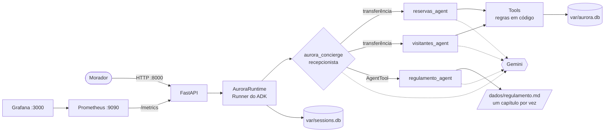

# Residencial Aurora — assistente virtual com Google ADK

<!-- TOC -->
**Sumário**

- [Residencial Aurora — assistente virtual com Google ADK](#residencial-aurora--assistente-virtual-com-google-adk)
  - [Arquitetura](#arquitetura)
  - [Garantias](#garantias)
  - [Como rodar](#como-rodar)
    - [Pré-requisitos](#pré-requisitos)
    - [Variáveis do `.env`](#variáveis-do-env)
    - [Subir, restaurar e parar](#subir-restaurar-e-parar)
    - [Testes](#testes)
    - [Quando algo dá errado](#quando-algo-dá-errado)
  - [Developers](#developers)
  - [LICENSE](#license)

<!-- TOC -->

Assistente do aplicativo dos moradores do Residencial Aurora. Pelo chat, o morador reserva o salão de festas, a churrasqueira e a quadra, cancela as próprias reservas, autoriza visitantes e tira dúvidas sobre o regulamento.

O assistente é construído com **Google ADK 2.11.0** e modelos **Gemini**, e é exposto por uma API **FastAPI** em `http://localhost:8000`. Princípio do projeto: **o modelo decide o caminho, o código decide o que é permitido.** Nenhuma regra crítica depende do prompt.

- Versão do projeto: [VERSION](VERSION) (`make version`)
- Documentação completa: [docs/](docs/) · Guia visual com diagramas e analogias: [docs/guia-visual.md](docs/guia-visual.md)
- Requisitos por sistema operacional: [REQUIREMENTS.md](REQUIREMENTS.md)
- Como contribuir: [CONTRIBUTING.md](CONTRIBUTING.md) · Histórico: [CHANGELOG.md](CHANGELOG.md)

---

## Arquitetura

> **Analogia:** o sistema é a portaria de um prédio. O morador fala com a **recepcionista** (agente principal), que chama o **setor** certo. Cada setor só age preenchendo **formulários oficiais** (tools), e o que custa dinheiro ou libera acesso precisa do **carimbo do morador** (confirmação pela API). Guia ilustrado para iniciantes: [docs/guia-visual.md](docs/guia-visual.md).



| Agente | Responsabilidade | Como é acionado | Por quê |
|---|---|---|---|
| `aurora_concierge` | Entende o pedido e delega. Não tem o regulamento nas instruções. | Raiz do `App`. **Toda mensagem de texto nova começa nele** ([`AuroraRunner`](src/aurora/runtime.py#L58)). | Triagem decidida em código: um especialista que atendeu o turno anterior não fica com um pedido fora do seu escopo. |
| `reservas_agent` | Disponibilidade, listar, reservar e cancelar reservas do apartamento da sessão. | Sub-agente, por transferência (`transfer_to_agent`). | Fluxo de vários turnos, com confirmação de tool. A confirmação precisa voltar ao agente que a pediu, e esse agente é o autor do evento da chamada. |
| `visitantes_agent` | Listar e autorizar visitantes do apartamento da sessão. | Sub-agente, por transferência. | Mesmo motivo: a autorização sempre pede confirmação. |
| `regulamento_agent` | Responde dúvidas lendo **um** capítulo de `dados/regulamento.md`. | `AgentTool` chamado pelo agente principal. | O `AgentTool` roda numa sessão isolada em memória: o texto do capítulo não entra no histórico persistido, só a resposta final (Garantia 4). |

Decisões e detalhes (incluindo o spike de confirmação com sessão persistida): [docs/arquitetura.md](docs/arquitetura.md).

**Modelos:** configuráveis por agente no `.env`. Padrão: `gemini-3.1-flash-lite` no agente principal e `gemini-2.5-flash` nos especialistas. Detalhes e cotas: [docs/como-rodar.md](docs/como-rodar.md#modelos-e-cotas-do-gemini).

---

## Garantias

| # | Garantia | Onde está no código | Por que não depende do modelo |
|---|---|---|---|
| 1 | **Cobrança ou acesso só com confirmação** | [`reservar_area`](src/aurora/tools/reservas.py#L71) decide em código: `taxa > 0` chama `tool_context.request_confirmation` ([reservas.py:101](src/aurora/tools/reservas.py#L101)). [`autorizar_visitante`](src/aurora/tools/visitantes.py#L25) sempre pede ([visitantes.py:48](src/aurora/tools/visitantes.py#L48)). Pendências calculadas dos eventos persistidos em [`pending_confirmations`](src/aurora/confirmations.py#L52). A rota só aceita `id` pendente ([runtime.py:235](src/aurora/runtime.py#L235) → 409) e confere que a tool executou ([runtime.py:253](src/aurora/runtime.py#L253)). | A tool só grava quando recebe um `ToolConfirmation` aprovado, e ele só existe se a API enviar o `FunctionResponse` de `adk_request_confirmation`. Texto do morador ("já confirmei") não gera esse objeto. Depois de respondido, o `id` deixa de estar pendente, então reenviar dá 409. |
| 2 | **Cada sessão pertence a um apartamento** | Sessão criada com `user_id = apartamento` e `state["apartamento"]` ([runtime.py:155](src/aurora/runtime.py#L155)). Todas as tools usam [`get_session_apartment`](src/aurora/tools/context.py#L24); nenhuma tem parâmetro `apartamento`. Filtros SQL por dono: [listagem](src/aurora/db/repository.py#L221) e [cancelamento](src/aurora/db/repository.py#L269). Disponibilidade só diz livre/ocupada: [`is_date_free`](src/aurora/db/repository.py#L208). | O modelo não tem como escolher o apartamento: ele vem do `user_id` imutável da sessão. O SQL nunca encontra uma reserva de outro apartamento, e a resposta de "não encontrada" é a mesma exista ou não a reserva ([reservas.py:179](src/aurora/tools/reservas.py#L179)). |
| 3 | **Nada se perde no reinício** | `DatabaseSessionService` em SQLite ([runtime.py:131](src/aurora/runtime.py#L131)) e `App` resumível ([runtime.py:138](src/aurora/runtime.py#L138)). Dados em `./var`, montado no container ([docker-compose.yml:27](docker-compose.yml#L27)). | Eventos, estado e confirmações pendentes ficam em disco. Uma aprovação enviada depois do reinício retoma a invocação certa (testado em `tests/unit/test_persistence.py` e no cenário C15). |
| 4 | **O regulamento é consultado, não carregado** | `regulamento_agent` é um [`AgentTool`](src/aurora/agents/__init__.py#L96). [`ler_capitulo`](src/aurora/tools/regulamento.py#L25) devolve um único capítulo, e [`buscar_no_regulamento`](src/aurora/tools/regulamento.py#L13) só títulos. A [instrução do agente principal](src/aurora/agents/prompts.py#L17) não contém o regulamento. | O `AgentTool` executa o especialista num `InMemorySessionService` separado; para a sessão do morador volta só a resposta final. Nenhum evento persistido recebe texto de capítulos. |
| 5 | **Dois moradores, uma reserva** | Índice único parcial [`ux_reserva_ativa`](src/aurora/db/schema.sql#L27) em `(area, data) WHERE status = 'ativa'`. Gravação em transação `BEGIN IMMEDIATE` ([repository.py:117](src/aurora/db/repository.py#L117)) em [`create_reservation`](src/aurora/db/repository.py#L226); a violação vira resposta normal "indisponível" ([repository.py:254](src/aurora/db/repository.py#L254)). | Quem decide o vencedor é o banco, no instante do `INSERT`. A conferência prévia é só para dar uma resposta amigável. A segunda aprovação recebe 200 com "indisponível". |

Explicação detalhada de cada garantia e dos testes que as cobrem: [docs/garantias.md](docs/garantias.md).

---

## Como rodar

### Pré-requisitos

- Ubuntu 22.04, 24.04 ou 26.04, ou macOS (Intel ou Apple Silicon). Veja o passo a passo do seu sistema em [REQUIREMENTS.md](REQUIREMENTS.md).
- Docker Engine com Compose v2 e Buildx (no macOS, via Colima), `make`, `git` e `curl`.
- [mise](https://mise.jdx.dev), que instala Python 3.12, uv e jq (`make install` faz isso no seu usuário).
- Uma chave do [Google AI Studio](https://aistudio.google.com/apikey).

```bash
make check-os            # confere o sistema e indica o arquivo de requisitos
make check-dependencies  # confere Docker, Compose, Buildx, mise, uv, jq...
make install             # instala mise (no usuário), ferramentas e dependências (uv sync)
```

### Variáveis do `.env`

```bash
cp .env.example .env     # preencha pelo menos GOOGLE_API_KEY
```

| Variável | Obrigatória | Padrão | Uso |
|---|---|---|---|
| `GOOGLE_API_KEY` | sim | — | Chave do Google AI Studio |
| `AURORA_MODEL_ROOT` | não | `gemini-3.1-flash-lite` | Modelo do agente principal |
| `AURORA_MODEL_SPECIALIST` | não | `gemini-2.5-flash` | Modelo dos especialistas |
| `AURORA_MODEL_RESERVAS`, `AURORA_MODEL_VISITANTES`, `AURORA_MODEL_REGULAMENTO` | não | `AURORA_MODEL_SPECIALIST` | Modelo de cada especialista (útil para dividir cotas) |
| `API_PORT` | não | `8000` | Porta da API no host |
| `PROMETHEUS_PORT` | não | `9090` | Porta do Prometheus no host |
| `GRAFANA_PORT` | não | `3000` | Porta do Grafana no host |
| `GRAFANA_ADMIN_USER`, `GRAFANA_ADMIN_PASSWORD` | não | `admin` / `admin` | Login do Grafana |
| `LOG_LEVEL` | não | `INFO` | Nível de log (`DEBUG` para diagnosticar) |
| `AURORA_ENABLE_DOCS` | não | `true` | Liga o Swagger em `/docs` |
| `AURORA_DB_PATH`, `AURORA_SESSIONS_DB_URL`, `AURORA_DADOS_DIR` | não | `./var/aurora.db`, `./var/sessions.db`, `./dados` | Armazenamento (no Docker já vêm configurados) |
| `UID`, `GID` | não | seu usuário | Dono dos arquivos criados em `./var` |

Variáveis vazias usam o padrão. Se uma porta estiver ocupada, o `make up` avisa qual processo a usa e sugere outro valor.

### Subir, restaurar e parar

```bash
make restore   # volta reservas e visitantes ao estado de dados/ (mantém as sessões)
make up        # sobe API, Prometheus e Grafana em primeiro plano (Ctrl+C para parar)
```

- API: `http://localhost:8000` · Swagger: `http://localhost:8000/docs`
- Prometheus: `http://localhost:9090` · Grafana: `http://localhost:3000` (admin/admin)
- `make reset` restaura os dados e também apaga todas as sessões.
- `make down` remove os containers. Os dados em `./var` continuam lá.

Sem Docker, também é possível rodar direto com uv: `uv run python -m aurora.restore` e `uv run python -m aurora`.

### Testes

```bash
make test-unit         # modelo falso, sem consumir cota
make test-integration  # fluxo do avaliador (passos 1-14 + C15) com Gemini real
make smoke             # mesmos cenários via curl, com resumo ✅/❌
```

Todos sobem a stack antes (`make up`) e derrubam depois (`make down`). Cenários manuais com Swagger e `curl`: [docs/cenarios-de-teste.md](docs/cenarios-de-teste.md).

### Quando algo dá errado

Os erros trazem a causa e a correção sugerida (`[ERRO] ... ↳ dica`). Os mais comuns:

| Sintoma | Causa provável | O que fazer |
|---|---|---|
| `make up` diz que a porta está em uso | Outro processo usa 8000/9090/3000 | Troque `API_PORT`, `PROMETHEUS_PORT` ou `GRAFANA_PORT` no `.env` |
| API responde 502 com `RESOURCE_EXHAUSTED` | Cota do Gemini esgotada | Espere, ou troque os modelos por agente no `.env` |
| API responde 502 com `API key` | `GOOGLE_API_KEY` inválida | Gere outra chave no AI Studio |
| `make test-unit` falha com `No module named 'aurora'` | O `.venv` foi criado antes de o repositório mudar de pasta | `make install` (recria o `.venv`) |
| `Permission denied` em `./var` | Arquivos de outro usuário | `sudo chown -R $(id -u):$(id -g) var` |

Mais diagnósticos: [docs/como-rodar.md](docs/como-rodar.md#diagnóstico-de-erros).

## Developers

- Aécio Pires — [linktree.com/aeciopires](https://linktree.com/aeciopires)

## LICENSE

MIT License — veja [LICENSE](LICENSE) para detalhes.
