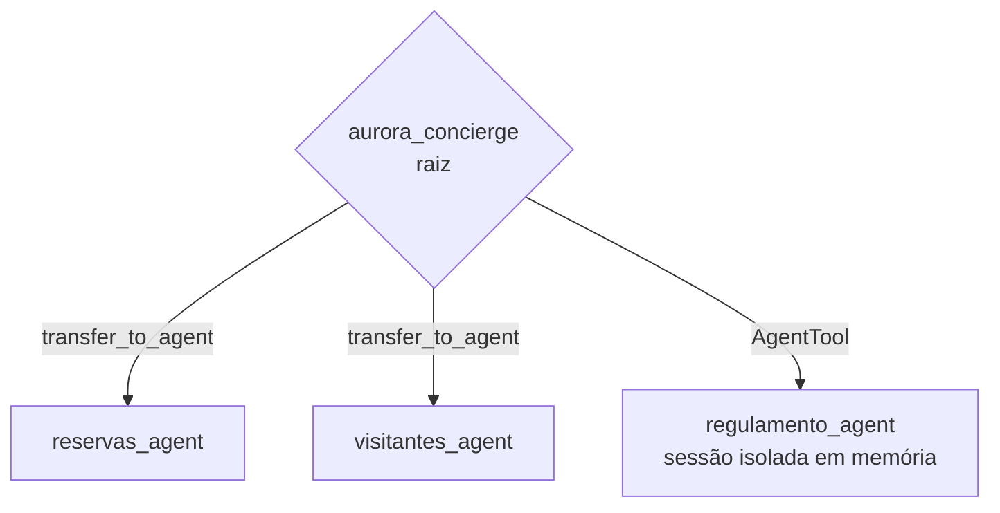

# Arquitetura

<!-- TOC -->
**Sumário**

- [Visão geral](#visão-geral)
- [Agentes](#agentes)
  - [`aurora_concierge`](#aurora_concierge)
  - [`reservas_agent` e `visitantes_agent`](#reservas_agent-e-visitantes_agent)
  - [`regulamento_agent`](#regulamento_agent)
- [Spike da confirmação (Fase 1)](#spike-da-confirmação-fase-1)
- [Fluxo de uma confirmação](#fluxo-de-uma-confirmação)
- [Persistência](#persistência)
- [Erros e diagnóstico](#erros-e-diagnóstico)
<!-- /TOC -->

> Para uma explicação passo a passo com diagramas e analogias, comece pelo [guia visual](guia-visual.md).

## Visão geral

| Componente | Tecnologia | Arquivo |
|---|---|---|
| API | FastAPI + Uvicorn (1 processo, async) | [src/aurora/api/main.py](../src/aurora/api/main.py) |
| Runtime de agentes | Google ADK 2.11.0 (`App`, `Runner`) | [src/aurora/runtime.py](../src/aurora/runtime.py) |
| Agentes | `LlmAgent` + `AgentTool` | [src/aurora/agents/](../src/aurora/agents/) |
| Tools | Funções Python async | [src/aurora/tools/](../src/aurora/tools/) |
| Dados do condomínio | SQLite (`./var/aurora.db`) | [src/aurora/db/](../src/aurora/db/) |
| Sessões | `DatabaseSessionService` em SQLite (`./var/sessions.db`) | [src/aurora/runtime.py](../src/aurora/runtime.py) |
| Métricas | `prometheus_client` + plugin do ADK | [src/aurora/metrics.py](../src/aurora/metrics.py) |

## Agentes

> **Analogia:** a recepcionista (raiz) passa o atendimento para um setor (transferência) quando o assunto exige vários passos e um carimbo do morador. Para o regulamento, ela manda um bilhete ao bibliotecário (`AgentTool`), que lê o livro em outra sala e devolve só a resposta.

### `aurora_concierge`
- **Faz:** triagem. Transfere reservas e visitantes, e chama o `regulamento_agent` para dúvidas.
- **Acionamento:** toda mensagem de texto nova começa nele. Isso é decidido em código pelo `AuroraRunner`, que sobrescreve `_find_agent_to_run`.
- **Por quê:** sem isso, o ADK manda a próxima mensagem para o último agente que respondeu. Nos testes com modelos menores, um especialista chegou a responder sobre a piscina sem consultar o regulamento.

### `reservas_agent` e `visitantes_agent`
- **Fazem:** reservas e visitantes do apartamento da sessão, sempre por tools.
- **Acionamento:** transferência a partir do agente principal.
- **Por quê:** a confirmação de tool do ADK é retomada no agente que pediu a confirmação. Com transferência, esse agente é o autor dos eventos `adk_request_confirmation`, e o `Runner` resumível usa isso para rotear a resposta.
- Ficam com `disallow_transfer_to_parent=False`. No spike, `True` fez a aprovação ser aceita sem executar nada.

### `regulamento_agent`
- **Faz:** responde dúvidas com `buscar_no_regulamento` (só títulos) e `ler_capitulo` (um capítulo).
- **Acionamento:** `AgentTool`.
- **Por quê:** o `AgentTool` cria um `Runner` com `InMemorySessionService` próprio. Os eventos com o texto do capítulo ficam nessa sessão descartável; para a sessão do morador volta só a resposta final. Assim o histórico não carrega o regulamento e as chamadas seguintes não ficam mais caras.

## Spike da confirmação (Fase 1)

Matriz testada com modelo falso, sessão em SQLite e "reinício" (Runner e serviço de sessão recriados):

| `resumability` | `disallow_transfer_to_parent` | Reinício | Tool executou |
|---|---|---|---|
| não | `False` | não / sim | 1 vez / 1 vez |
| não | `True` | não / sim | **0** / **0** |
| sim | `False` | não / sim | 1 vez / 1 vez |
| sim | `True` | não / sim | **0** / **0** |

Escolha: `resumability` ligada e sub-agentes transferíveis. Com `resumability`, a resposta da confirmação é roteada pela chamada `adk_request_confirmation` (função `find_matching_function_call` do ADK), e não pelo último agente que falou. Isso continua correto mesmo que o morador mande outras mensagens antes de aprovar.

Como proteção extra, a rota de confirmações confere se a tool original produziu uma resposta depois da aprovação. Se não produziu, registra um erro explicando o problema de roteamento e responde 500, em vez de falhar em silêncio.

## Fluxo de uma confirmação

> Diagramas de sequência completos (mensagem, confirmação, reinício, regulamento e disputa): [guia-visual.md](guia-visual.md).

1. O morador pede "Reserve o salão de festas para 2030-04-20".
2. `aurora_concierge` transfere para `reservas_agent`, que chama `reservar_area`.
3. A tool vê `taxa > 0` e chama `tool_context.request_confirmation(...)`.
4. O ADK grava um evento `adk_request_confirmation` e pausa a invocação.
5. A API lê os eventos e devolve `confirmacoes_pendentes = [{id, acao, detalhes}]`.
6. `POST /confirmacoes` confere se o `id` está pendente e envia `FunctionResponse(name="adk_request_confirmation", id=..., response={"confirmed": true|false})`.
7. O ADK retoma a invocação no `reservas_agent`, que executa `reservar_area` de novo, agora com `tool_context.tool_confirmation` preenchido.

## Persistência

- `./var/aurora.db`: `apartamentos`, `areas`, `reservas` (cancelamento lógico), `codigos_emitidos` (nunca apagada), `visitantes` e `sessoes` (dono de cada sessão). Schema: [schema.sql](../src/aurora/db/schema.sql).
- `./var/sessions.db`: tabelas do ADK (`sessions`, `events`, `app_states`, `user_states`).
- Ambos em modo WAL, com `busy_timeout` de 30 s.
- `make restore` recarrega reservas e visitantes de `dados/` e mantém os códigos já emitidos e as sessões. `make reset` também apaga as sessões.

## Erros e diagnóstico

- **Plugin `MetricsPlugin`:** registra erro do modelo e de tool com agente, modelo, argumentos e uma dica (chave, cota, nome do modelo, rede).
- **Erro de tool:** vira uma resposta estruturada `{"status": "erro"}` para o modelo, e o turno não é derrubado.
- **Falha do modelo:** a API responde 502 com a causa e a dica. Uma nota é gravada na sessão para o modelo não reexecutar a mensagem que falhou.
- **Inicialização:** a API registra um erro se a `GOOGLE_API_KEY` estiver vazia ou se o banco ou a pasta `dados/` não estiverem acessíveis.
