# Guia visual para iniciantes

<!-- TOC -->
**Sumário**

- [Guia visual para iniciantes](#guia-visual-para-iniciantes)
  - [1. Glossário com analogias](#1-glossário-com-analogias)
  - [2. Visão geral da arquitetura](#2-visão-geral-da-arquitetura)
  - [3. Os agentes e quem atende o quê](#3-os-agentes-e-quem-atende-o-quê)
    - [Quem o Runner escolhe](#quem-o-runner-escolhe)
  - [4. Fluxo de uma mensagem pela API](#4-fluxo-de-uma-mensagem-pela-api)
  - [5. Fluxo de uma confirmação (Garantia 1)](#5-fluxo-de-uma-confirmação-garantia-1)
    - [Ciclo de vida de uma confirmação](#ciclo-de-vida-de-uma-confirmação)
  - [6. Cada sessão pertence a um apartamento (Garantia 2)](#6-cada-sessão-pertence-a-um-apartamento-garantia-2)
  - [7. Nada se perde no reinício (Garantia 3)](#7-nada-se-perde-no-reinício-garantia-3)
  - [8. O regulamento é consultado, não carregado (Garantia 4)](#8-o-regulamento-é-consultado-não-carregado-garantia-4)
  - [9. Dois moradores, uma reserva (Garantia 5)](#9-dois-moradores-uma-reserva-garantia-5)
  - [10. Modelo de dados](#10-modelo-de-dados)
    - [Ciclo de vida de uma reserva](#ciclo-de-vida-de-uma-reserva)
  - [11. Principais classes e módulos](#11-principais-classes-e-módulos)
  - [12. Infraestrutura e comandos](#12-infraestrutura-e-comandos)
    - [Containers](#containers)
  - [13. Testes](#13-testes)
  - [14. Observabilidade e erros](#14-observabilidade-e-erros)
  - [15. Para onde ir depois](#15-para-onde-ir-depois)

<!-- TOC -->

Este guia explica o projeto com diagramas e analogias. Os diagramas usam [Mermaid](https://mermaid.js.org/) e aparecem desenhados no GitHub e no VS Code (com a extensão de pré-visualização de Markdown/Mermaid).

> **A analogia central:** o sistema funciona como a **portaria de um prédio**. O morador fala com a recepção, a recepção chama o setor certo, e cada setor só faz o que o **livro de regras** (o código) permite. A recepcionista pode ser simpática e conversar de tudo, mas não tem a chave do cofre: quem abre o cofre é o regulamento escrito.

## 1. Glossário com analogias

| Termo técnico | O que é | Analogia no condomínio |
|---|---|---|
| **API** (FastAPI) | Porta de entrada HTTP do sistema | O **balcão da portaria**, onde todo pedido chega |
| **Sessão** | Uma conversa com histórico salvo | A **ficha de atendimento** de um morador, presa a um apartamento |
| **Agente** (LlmAgent) | Um "atendente" movido por um modelo de IA | Um **funcionário** do condomínio |
| **Agente principal** (`aurora_concierge`) | Recebe tudo e decide quem atende | A **recepcionista** |
| **Especialista** | Agente focado num assunto | Os **setores**: reservas, portaria de visitantes, biblioteca do regulamento |
| **Modelo** (Gemini) | A IA que entende texto e escolhe ações | O **cérebro** do funcionário: entende o pedido, mas não decide as regras |
| **Tool** | Função Python que o agente pode chamar | Um **formulário oficial**: o funcionário só consegue agir preenchendo um |
| **Confirmação de tool** | Pausa até o morador aprovar pelo app | O **carimbo do morador**: sem carimbo, o formulário não é processado |
| **Runner** (ADK) | Motor que executa os agentes | O **gerente de turno**, que decide qual funcionário atende agora |
| **AgentTool** | Agente usado como ferramenta, numa sala separada | O **bibliotecário**: consulta o livro em outra sala e volta só com a resposta |
| **SQLite** | Banco de dados em arquivo | O **livro de registros** do condomínio |
| **Índice único** | Regra do banco que impede duplicatas | A **agenda com uma única linha por dia**: escreveu, ninguém mais escreve |
| **Docker / Compose** | Empacota e sobe os serviços | O **prédio pré-montado**, com tudo instalado igual em qualquer terreno |
| **Prometheus / Grafana** | Coleta e mostra métricas | O **contador de visitas** e o **painel da sala da síndica** |

## 2. Visão geral da arquitetura

**Analogia:** o prédio tem uma portaria (API) com funcionários (agentes), um livro de registros (banco) e uma sala de monitoramento (Prometheus e Grafana).

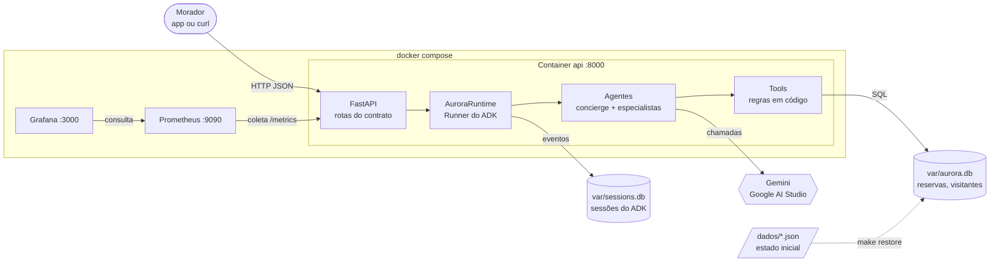

| Camada | Pasta | Responsabilidade |
|---|---|---|
| API | `src/aurora/api/` | Valida a entrada, aplica o contrato, traduz erros em 404, 409 e 502 |
| Runtime | `src/aurora/runtime.py` | Cria sessões, roda os agentes, controla confirmações e roteamento |
| Agentes | `src/aurora/agents/` | Instruções e árvore de agentes |
| Tools | `src/aurora/tools/` | Únicas portas para ler e gravar dados; aplicam as regras |
| Dados | `src/aurora/db/` | SQL, schema, seed e restore |

## 3. Os agentes e quem atende o quê

**Analogia:** a recepcionista (`aurora_concierge`) ouve todo pedido novo. Assuntos de reserva vão para o **setor de reservas**, visitantes vão para a **portaria**, e dúvidas de regra vão para o **bibliotecário**, que consulta o livro numa sala fechada e volta só com a resposta.

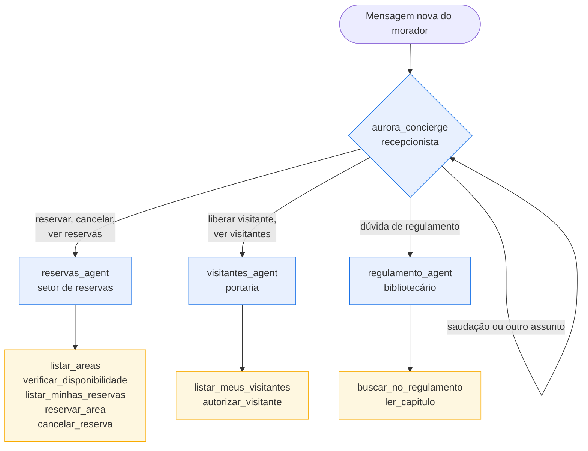

| Agente | Como é chamado | Por quê |
|---|---|---|
| `aurora_concierge` | Toda mensagem de texto nova começa nele (decidido em código pelo `AuroraRunner`) | Um setor não fica com um assunto que não é dele |
| `reservas_agent` | Transferência (`transfer_to_agent`) | Conversa de vários turnos; a confirmação precisa voltar para ele |
| `visitantes_agent` | Transferência | Idem; liberar visitante sempre pede confirmação |
| `regulamento_agent` | `AgentTool` (como uma ferramenta) | Sala separada: o texto do regulamento não entra na ficha do morador |

### Quem o Runner escolhe

**Analogia:** o gerente de turno olha o tipo de papel que chegou. Pedido novo vai para a recepção. Carimbo de aprovação volta para o setor que pediu o carimbo.

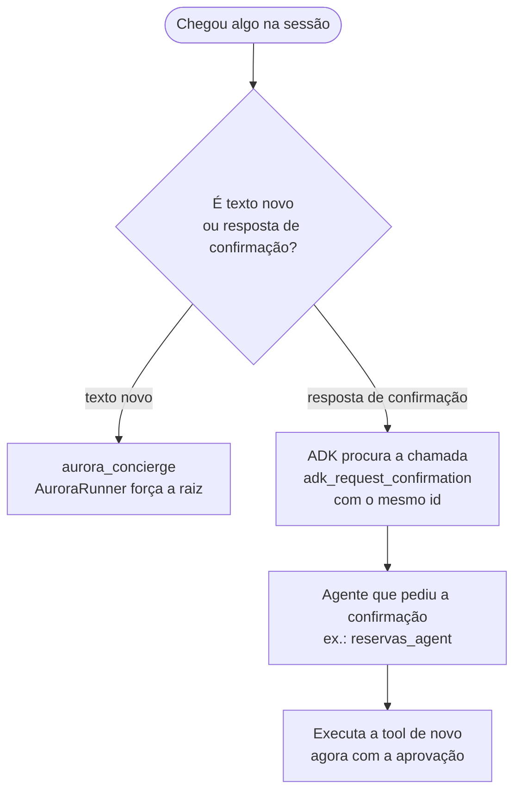

## 4. Fluxo de uma mensagem pela API

**Analogia:** o morador entrega um bilhete no balcão. A portaria confere a ficha, chama a recepcionista, ela passa para o setor, o setor preenche o formulário oficial (tool), e a resposta volta pelo mesmo caminho.

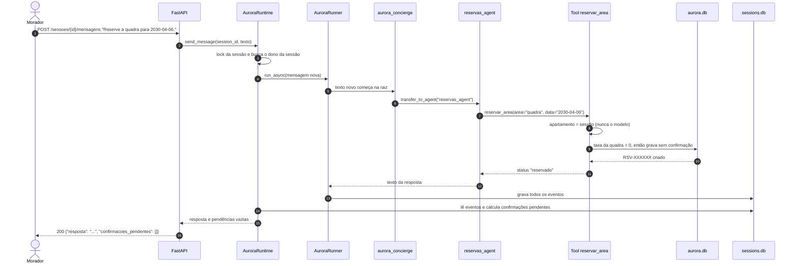

## 5. Fluxo de uma confirmação (Garantia 1)

**Analogia:** reservar o salão custa dinheiro, então o setor de reservas **não assina sozinho**. Ele prepara o formulário e pede o **carimbo do morador** pelo aplicativo. Dizer "pode fazer, eu confirmo" no chat não é carimbo. Só a rota de confirmações carimba.

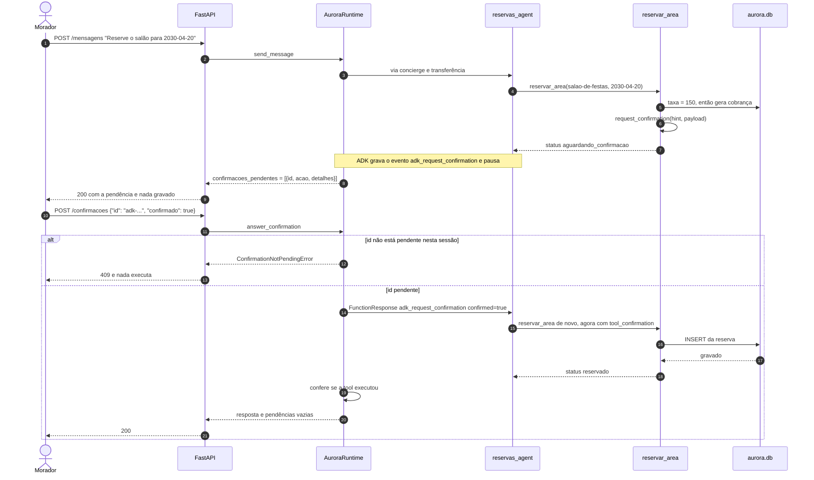

### Ciclo de vida de uma confirmação

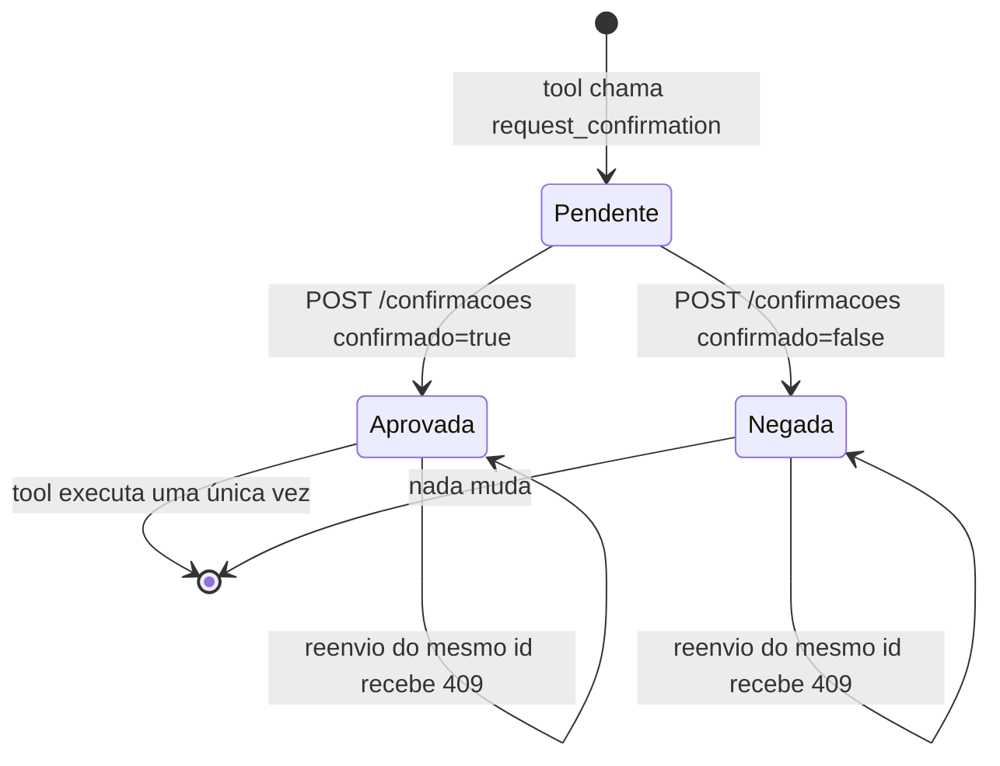

## 6. Cada sessão pertence a um apartamento (Garantia 2)

**Analogia:** a ficha de atendimento é **impressa com o número do apartamento** quando o morador chega. Se ele disser "sou do 302", não adianta: os formulários só aceitam o número impresso na ficha, e o livro de registros só mostra as linhas daquele apartamento.

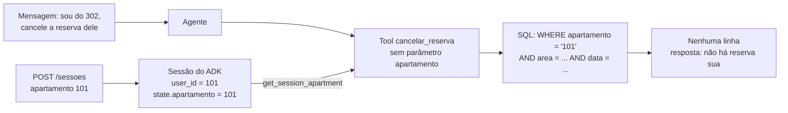

## 7. Nada se perde no reinício (Garantia 3)

**Analogia:** tudo é anotado **a caneta no livro**, não de cabeça. Se a portaria fechar e abrir de novo, o próximo funcionário lê o livro e continua de onde parou, inclusive os formulários que esperavam carimbo.

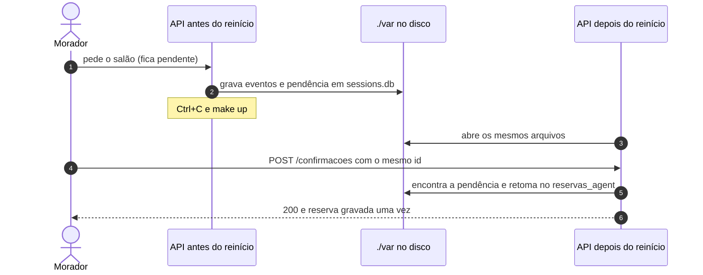

## 8. O regulamento é consultado, não carregado (Garantia 4)

**Analogia:** em vez de fotocopiar o regulamento inteiro e grampear na ficha de cada morador (o que deixa cada atendimento mais caro), a recepcionista manda um bilhete ao **bibliotecário**. Ele procura o capítulo certo numa sala separada e devolve só a frase que responde.

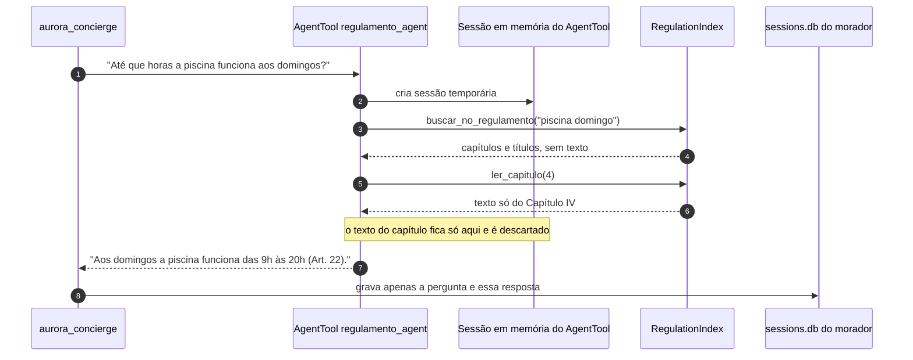

## 9. Dois moradores, uma reserva (Garantia 5)

**Analogia:** a agenda do salão tem **uma linha por dia, escrita a caneta**. Dois moradores podem correr até a agenda ao mesmo tempo, mas só um consegue escrever. O outro encontra a linha preenchida e recebe um "já está reservado", sem confusão.

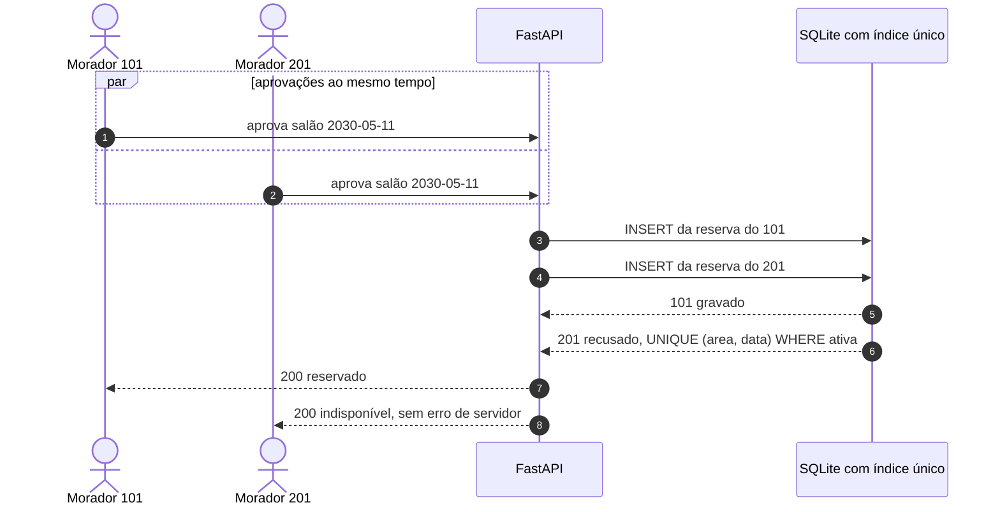

## 10. Modelo de dados

**Analogia:** cada tabela é um **caderno** do livro de registros.

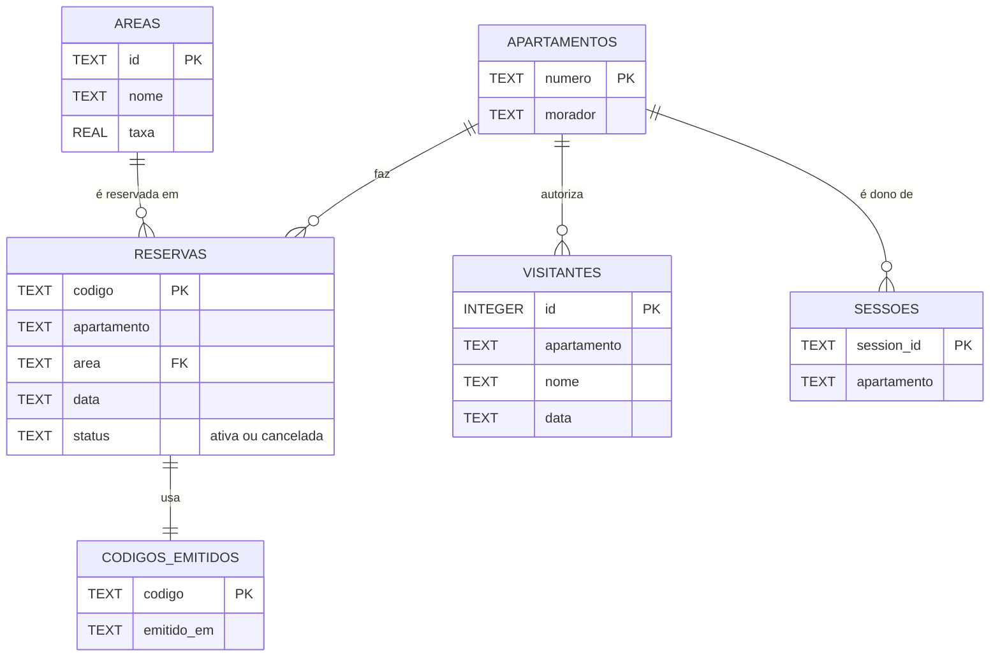

| Tabela | Cuidado especial |
|---|---|
| `reservas` | Índice único `(area, data)` só para `status = 'ativa'`. Cancelar muda o status, não apaga a linha |
| `codigos_emitidos` | Nunca é apagada, nem pelo restore. Garante que um código não se repete |
| `sessoes` | Liga o `session_id` ao apartamento dono, definido uma única vez |

### Ciclo de vida de uma reserva

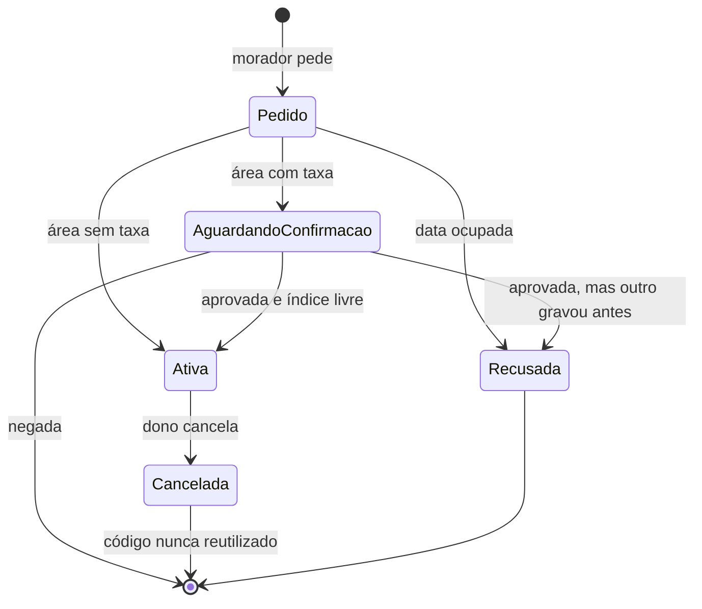

## 11. Principais classes e módulos

**Analogia:** é o **organograma** do condomínio: quem conhece quem e quem chama quem.

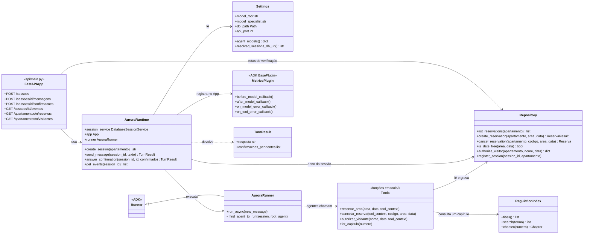

As tools são funções, não classes (aparecem como `Tools` no diagrama). Elas usam o `Repository` e o `RegulationIndex` por meio de `aurora.services` e pegam o apartamento com `get_session_apartment(tool_context)`.

## 12. Infraestrutura e comandos

**Analogia:** o `make` é o **controle remoto** do prédio. Cada botão faz uma tarefa e confere antes se é seguro: sistema suportado, `.env` presente, portas livres.

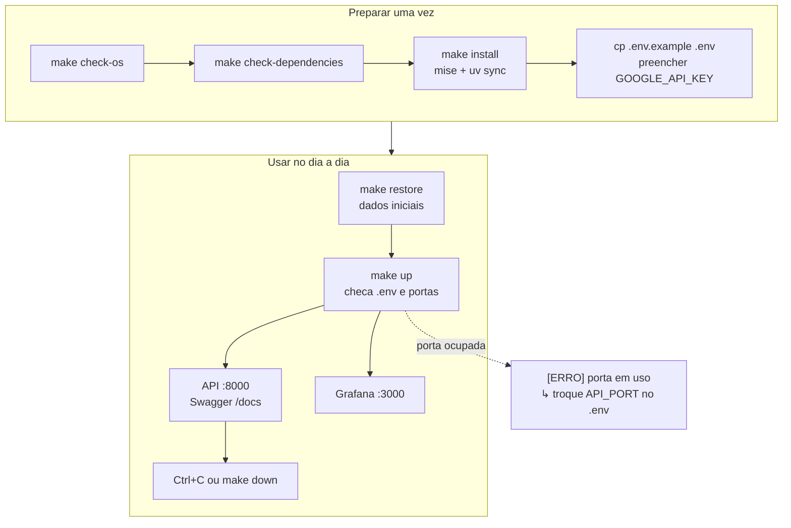

### Containers

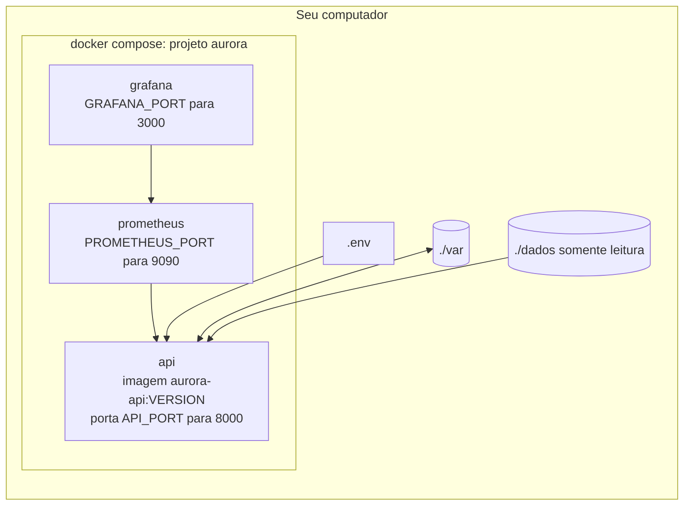

## 13. Testes

**Analogia:** os testes unitários são um **ensaio com atores**. Um modelo falso segue um roteiro fixo, então dá para testar as regras rápido e de graça. Os testes de integração são o **dia de inauguração**: o Gemini de verdade, o Docker de verdade e o mesmo roteiro do avaliador.

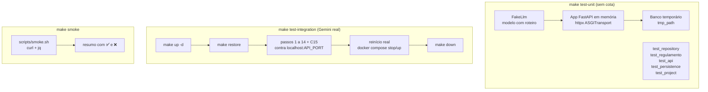

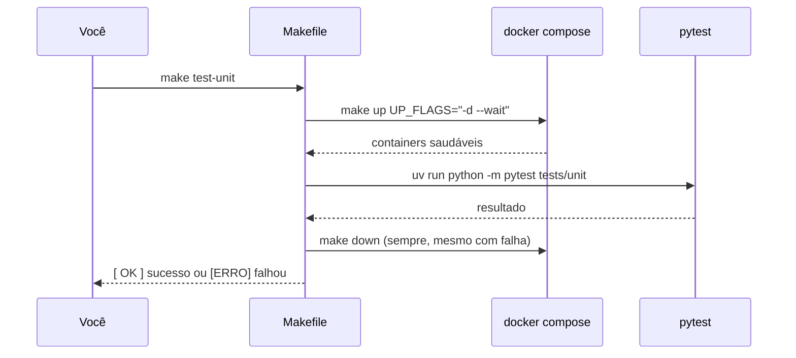

| Tipo | Onde | Usa o Gemini | Para que serve |
|---|---|---|---|
| Unitário | `tests/unit` | Não | Regras, garantias, contrato e consistência do repositório |
| Integração | `tests/integration` | Sim | Fluxo completo do avaliador, incluindo reinício e disputa |
| Smoke | `scripts/smoke.sh` | Sim | Mesmos cenários via `curl`, fácil de ler e repetir |

## 14. Observabilidade e erros

**Analogia:** o Prometheus é o **porteiro que anota tudo numa prancheta** a cada 10 segundos. O Grafana é o **painel na sala da síndica**. Quando algo falha, o sistema deixa um **bilhete explicando o motivo e o que fazer**, em vez de só "deu erro".

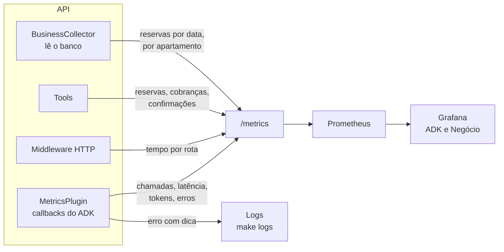

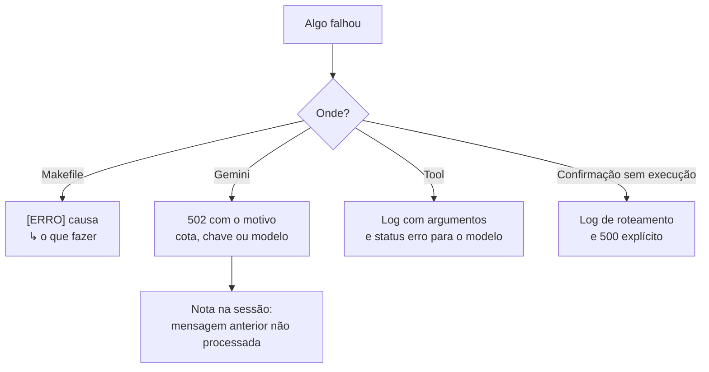

## 15. Para onde ir depois

| Quero... | Leia |
|---|---|
| Rodar o projeto | [como-rodar.md](como-rodar.md) |
| Entender as decisões | [arquitetura.md](arquitetura.md) |
| Ver cada garantia em detalhe | [garantias.md](garantias.md) |
| Testar pelo navegador | [cenarios-de-teste.md](cenarios-de-teste.md) e `http://localhost:8000/docs` |
| Conhecer as rotas | [api.md](api.md) |
| Ver métricas e dashboards | [observabilidade.md](observabilidade.md) |
| Rodar os testes | [testes.md](testes.md) |
